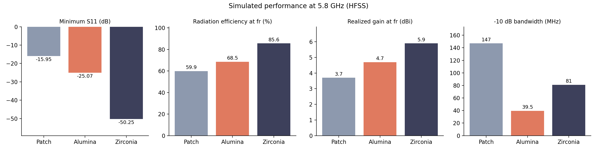
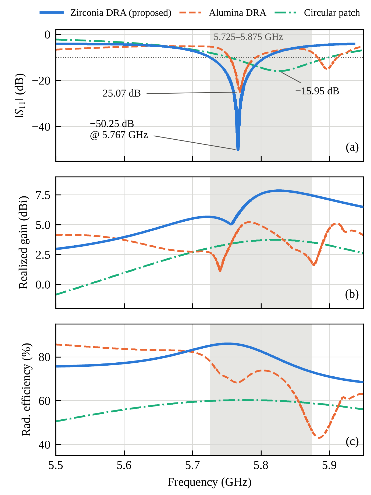
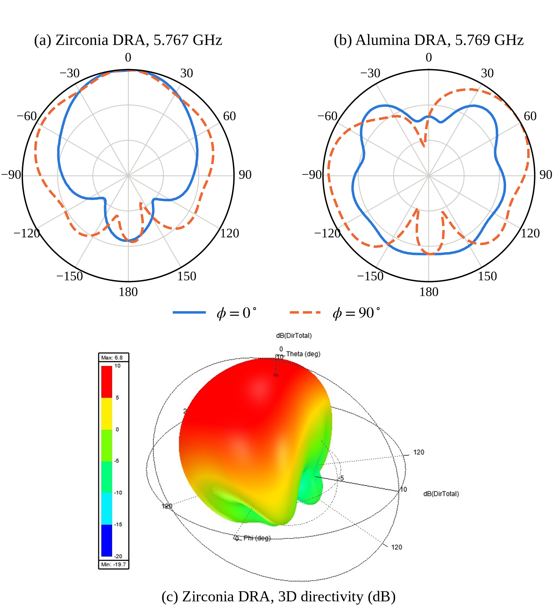
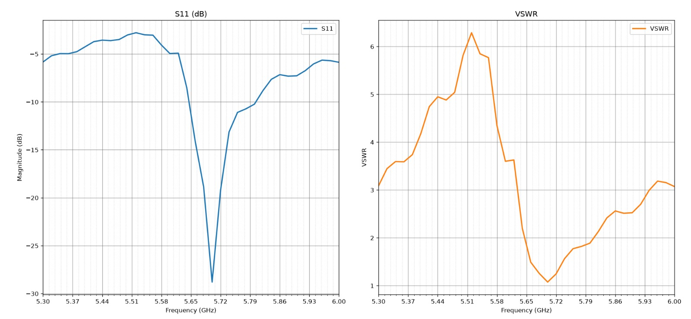

# Design and Development of Dielectric Resonator Antenna for Various Applications

**Featured study: Compact Zirconia Cylindrical DRA for 5.8 GHz**

Simulation models, results, paper and presentation for a microstrip-fed **zirconia (ZrO₂, εr = 23) cylindrical dielectric resonator antenna** for the 5.725-5.875 GHz band, compared like-for-like against an **alumina (εr = 9.9) CDRA** and a **circular microstrip patch**. A multiband zirconia design with a 12-sided parasitic ring is included as future scope.

> Pillai College of Engineering (Autonomous), Navi Mumbai, India, Department of Electronics and Telecommunication Engineering.
> Authors: Adhil Anil Pillai, Om Prakash Shinde, Bagavath Kumar P., Jyotilipsa Mishra. Faculty guide: Dr. Ameet Mehta.

## Why zirconia?

A review of twenty DRA papers found alumina as the resonator in twelve of them and zirconia as the resonator in none. Zirconia's permittivity (≈ 22-30) is two to three times that of alumina, so the resonator can be much smaller. This project quantifies that on one shared board and feed.

## Headline results (HFSS simulation)

| | Circular patch | Alumina CDRA | **Zirconia CDRA** |
|---|---|---|---|
| Resonator | Cu on FR-4 | Ø42.4 × 15 mm | **Ø12.4 × 10 mm** |
| Resonant frequency | 5.827 GHz | 5.769 GHz | **5.767 GHz** |
| Minimum S11 | −15.95 dB | −25.07 dB | **−50.25 dB** |
| VSWR at resonance | 1.38 | 1.12 | **1.006** |
| −10 dB bandwidth | 147 MHz (2.52 %) | 39.5 MHz (0.68 %) | 81 MHz (1.41 %) |
| Realized gain at fr | 3.7 dBi | 4.7 dBi | **5.9 dBi** (7.85 dBi peak) |
| Radiation efficiency at fr | 59.9 % | 68.5 % | **85.6 %** |
| Peak directivity (3D) | 6.1 dBi | 6.4 dBi | 6.8 dBi |
| Main beam | broadside | off-axis | broadside |
| Resonator volume | n/a | 21 179 mm³ | **1 208 mm³** (−94.3 %) |

The price of the higher permittivity is bandwidth (81 MHz vs 147 MHz for the patch). The parasitic-ring extension widens the 5.8 GHz band to 283 MHz in simulation.



| S11, gain and efficiency (paper Fig. 3) | Radiation patterns (paper Fig. 4) |
|---|---|
|  |  |

### Preliminary measurement

A fabricated zirconia CDRA was measured on an Anritsu ShockLine MS46122B VNA (22 Sep 2026): resonance **≈ 5.70 GHz, S11 ≈ −28.8 dB, VSWR ≈ 1.08** (read from the plot), compared with 5.767 GHz and −50.25 dB simulated. See [docs/measurement.md](docs/measurement.md). This measurement is **not yet in the paper**, which lists fabrication as future work.



## Repository layout

```
hfss/                        Ansys HFSS / Electronics Desktop projects (.aedt)
  circular_patch/            27 x 24 mm inset-fed circular patch (reference)
  alumina_cdra/              Ø42.4 x 15 mm alumina cylinder on 60 x 60 mm board
  zirconia_cdra/             Ø12.4 x 10 mm zirconia cylinder (proposed design)
  zirconia_parasitic_ring/   zirconia cylinder + 12-sided zirconia ring (future scope)
results/
  figures/<design>/          HFSS plots, CAD drawings, model screenshots
  figures/paper/             figures as published in the paper
  figures/comparison/        charts generated by analysis/compare_results.py
  measurements/              VNA screenshots and lab photo
  data/                      results_summary.json (single source of truth) + generated table
analysis/                    Python helpers (design equations, S11/VSWR, overlay plots)
tests/                       unit tests that cross-check paper numbers
docs/
  paper/                     manuscript (.docx)
  presentation/              project slides (.pptx)
  literature_review.md       the 20 reviewed papers at a glance
  reproducing_in_hfss.md     how to rebuild and re-run each model
  measurement.md             prototype measurement log and next steps
  KNOWN_ISSUES.md            inconsistencies between paper, slides and HFSS files
```

## Quick start

Requires Python 3.10+ (only `matplotlib` for plotting).

```bash
git clone https://github.com/OmPShinde/Design-and-Development-of-Dielectric-Resonator-Antenna-for-Various-Applications.git
cd Design-and-Development-of-Dielectric-Resonator-Antenna-for-Various-Applications
pip install -r requirements.txt

python -m unittest discover -s tests -v   # cross-check paper numbers
python -m analysis.design_calcs           # print every analytically derived number
python -m analysis.compare_results        # rebuild comparison table + charts
```

Overlay an HFSS export with a VNA file (HFSS CSV `Freq [GHz], dB(S(1,1))` and a `.s1p`):

```bash
python -m analysis.overlay_s11 --sim results/data/zirconia_cdra_s11_hfss.csv \
    --meas results/measurements/zirconia_cdra.s1p \
    --out results/figures/comparison/zirconia_sim_vs_meas.png
```

To re-run the simulations you need Ansys Electronics Desktop with HFSS; see [docs/reproducing_in_hfss.md](docs/reproducing_in_hfss.md).

## Design summary

All antennas use a 1.6 mm FR-4 substrate (εr = 4.4, tan δ = 0.02), a copper ground plane, and a 3 mm microstrip feed, with a wave-port excitation and a radiation boundary.

| Parameter | Patch | Zirconia DRA | Alumina DRA |
|---|---|---|---|
| Substrate (mm) | 27 × 24 × 1.6 | 60 × 60 × 1.6 | 60 × 60 × 1.6 |
| Feed width (mm) | 3 | 3 | 3 |
| Radiator radius (mm) | 6.7 | 6.2 | 21.2 |
| Resonator height (mm) | n/a | 10 | 15 |
| Inset slots (mm) | 8 × 0.5 | n/a | n/a |
| Material (εr) | Copper | ZrO₂ (23) | Al₂O₃ (9.9) |

## Known inconsistencies, please read

The paper, slides and HFSS files disagree on a few values (loss tangents, alumina εr, some summary-table numbers). [docs/KNOWN_ISSUES.md](docs/KNOWN_ISSUES.md) lists each one and which source this repo treats as authoritative. **The paper's numbers are used throughout.**

## Roadmap

- [ ] Export HFSS S11 / gain / efficiency curves to CSV and commit them under `results/data/`
- [ ] Export the VNA trace as `.s1p` and add a simulated-vs-measured overlay
- [ ] Re-simulate with the loss tangents actually reported in the paper (see KNOWN_ISSUES)
- [ ] Anechoic-chamber pattern and gain measurement
- [ ] Tune the parasitic ring size and gap; identify the mode behind each band
- [ ] 3D-printed or sintered zirconia prototypes

## Citation

See [CITATION.cff](CITATION.cff) (GitHub shows a "Cite this repository" button). Please also cite the paper once published.

## License

Code and data: [MIT](LICENSE). The HFSS project files, the manuscript and the slides are shared for academic use; change the licence if your institution requires something else.
